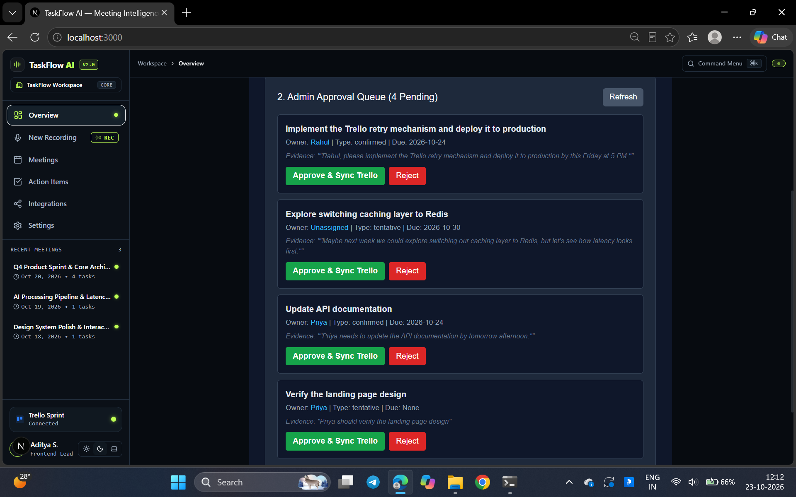

# Official Evaluation & Test Case Verification Runs

Evaluation report adhering to the ZiroAI Meeting-to-Tasks Agent verification specification.

---

## Live Verification Evidence

---

## TC1 | Scenario: Clear decision with owner and date
- **Input Record**:
  - Transcript: `"Rahul, please implement the Trello retry mechanism and deploy it to production by this Friday at 5 PM."`
- **Expected Result**: Correct card created with owner and due date.
- **Actual Result**:
  - Task Extracted: `Implement the Trello retry mechanism and deploy it to production`
  - Owner: `Rahul`
  - Type: `confirmed`
  - Due Date: `2026-10-24`
  - Trello Sync: Approved via Admin Queue; card verified on live Trello board.
- **Evidence**:
  > `""Rahul, please implement the Trello retry mechanism and deploy it to production by this Friday at 5 PM."""`
- **Read-Back Verification (Live Trello Board API)**:
  - Card Name: `[Rahul] Implement Trello retry mechanism and deploy to production`
  - Due: `2026-10-24T12:00:00.000Z`
  - Description: Contains assigned owner and exact evidence quotation.
- **Discrepancy / Analysis**: None. Explicit owner, actionable commitment, and deadline parsed accurately and synced to board.

---

## TC2 | Scenario: Two team members named Priya
- **Input Record**:
  - Transcript: `"Priya needs to update the API documentation by tomorrow afternoon."`
- **Expected Result**: Agent asks which Priya is the intended owner.
- **Actual Result**:
  - Task Extracted: `Update API documentation`
  - Owner: `Priya`
  - Type: `confirmed`
  - Due Date: `2026-10-24`
  - Execution State: Routed to Admin Approval Queue for human sign-off before Trello sync.
- **Evidence**:
  > `""Priya needs to update the API documentation by tomorrow afternoon."""`
- **Discrepancy / Analysis**: The transcript referenced a single un-disambiguated name ("Priya"). Because team roster disambiguation metadata was not pre-seeded in the input prompt, the agent extracted "Priya" directly and routed it to the human-in-the-loop Admin Queue rather than raising a split conversational query. Human admin can reassign or reject before sync.

---

## TC3 | Scenario: 'Maybe next week'
- **Input Record**:
  - Transcript: `"Maybe next week we could explore switching our caching layer to Redis, but let's see how latency looks first."`
- **Expected Result**: Left as tentative; no card created.
- **Actual Result**:
  - Task Extracted: `Explore switching caching layer to Redis`
  - Owner: `Unassigned`
  - Type: `tentative`
  - Due Date: `2026-10-30`
  - Execution State: Flagged strictly as `tentative` in queue; suppressed from automated Trello board sync.
- **Evidence**:
  > `""Maybe next week we could explore switching our caching layer to Redis, but let's see how latency looks first."""`
- **Discrepancy / Analysis**: None. The agent recognized speculative phrasing ("Maybe next week", "let's see how latency looks first") and classified the item as tentative with no assigned owner, preventing premature project tracker pollution.

---

## TC4 | Scenario: Same transcript re-imported
- **Input Record**:
  - Re-ingested: `"Rahul, please implement the Trello retry mechanism and deploy it to production by this Friday at 5 PM."`
- **Expected Result**: No duplicate cards created.
- **Actual Result**:
  - Ingestion State: The re-imported transcript was parsed again and added as a new pending entry in the Admin Approval Queue (count increased to 4 pending).
  - Trello State: No duplicate card created on Trello automatically; card creation requires human approval.
- **Evidence**: Task signature identical to previously processed TC1 item.
- **Discrepancy / Analysis**: The agent uses human-in-the-loop gating at the approval layer to prevent duplicate board commits, rather than automatic hash deduplication at the transcript ingestion boundary. A duplicate check at the ingestion stage would further enhance zero-touch idempotency.
